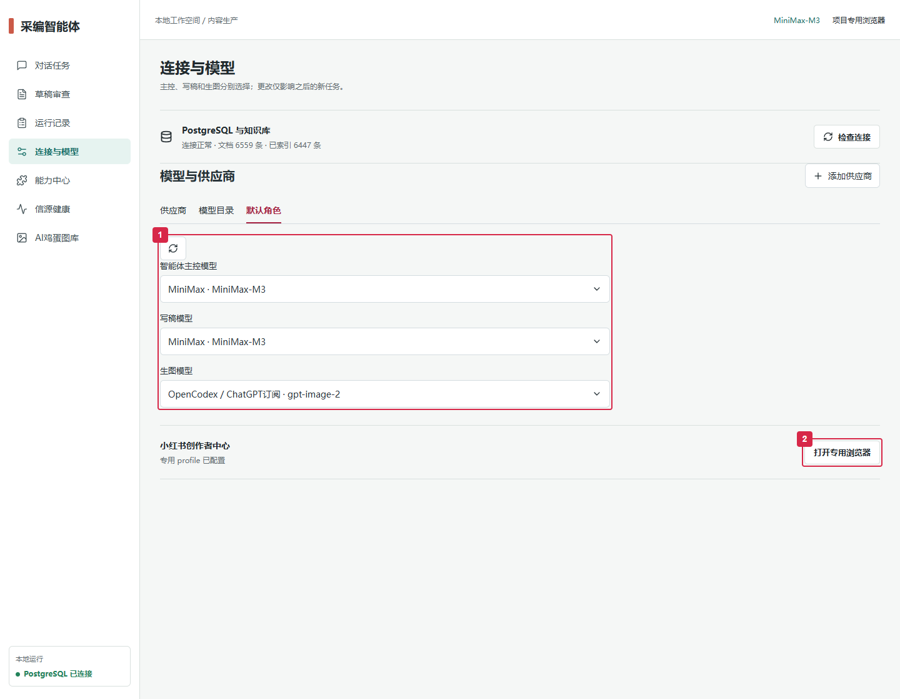
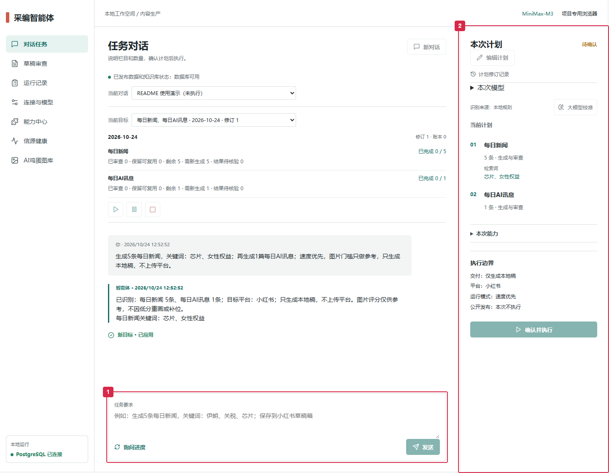
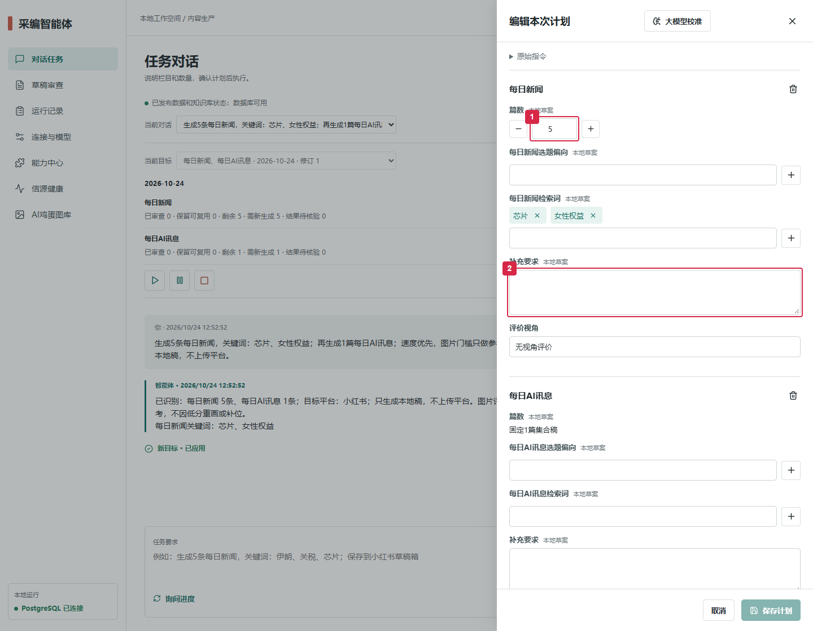
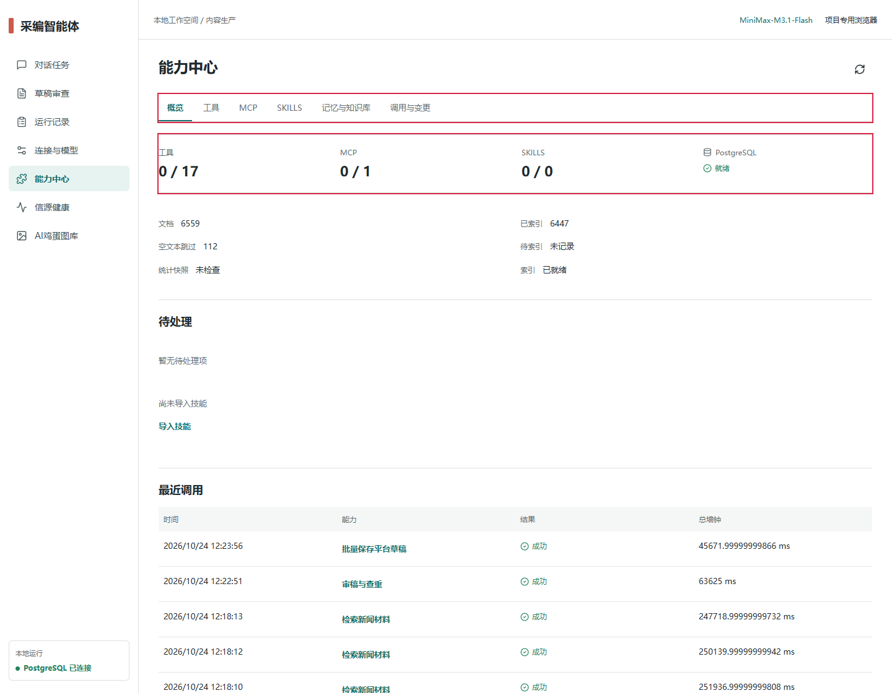

# 采编智能体 · Redbook Auto Agent

通过对话安排选题、写稿、配图、审核和平台草稿保存。React + Vite 前端、Python/FastAPI 后端、LangGraph 执行图和 PostgreSQL/pgvector 知识库，面向 **Windows 本地使用**。

> 文档核对：2026-10-24。功能、限制和耗时来自当前源码、界面及本机运行记录。源码、运行数据分开存放；克隆仓库不包含密钥、数据库、浏览器登录态或生图账号。

这是独立智能体。需要表单和人工 CLI 时使用 [工作流仓库](https://github.com/bty3052771076-tech/auto_redbook)。本仓库自带 `tools/redbook_tools`，运行不依赖旧工作流目录；两边后续修改不会自动同步。

## 1. 功能

| 功能 | 能做什么 | 入口 |
| --- | --- | --- |
| 对话任务 | 本地识别需求，展示可编辑计划；可选大模型校准 | 对话任务 |
| 每日新闻 | 多信源采集、日期/事件查重、正文与评价、AI 配图 | 对话任务 |
| 每日 AI 讯息 | 优先模型发布和厂商动态，近两天核验，按质量决定资讯数量 | 对话任务 |
| 每日我去 | 筛选新鲜、可核验的反常新闻，生成带栏目标识的图文 | 对话任务 |
| AI 鸡蛋 / AI 福利 | 查找可领取福利；参考图与厂商人设双图描改 | 对话任务、AI鸡蛋图库 |
| 全球事件关注图 | 汇总有来源、日期和坐标的事件并渲染地图 | 对话任务；需要地图资源 |
| 草稿审查 | 查看正文、图片、来源、日期和平台回执 | 草稿审查 |
| 数据与选题 | 同步已发布内容与可采集指标，辅助选题和历史查重 | 工具、任务执行 |
| 模型管理 | 主控/写稿/生图分别绑定；自定义供应商、模型与端点 | 连接与模型 |
| 断点续跑 | 同一对话补齐缺口，复用合格稿件及保存回执 | 对话中发送“继续” |
| 知识库与上下文 | PostgreSQL 持久化、向量/文本检索、历史压缩与用量记录 | 能力中心 |
| 工具 / MCP / SKILLS | 查看、配置、启停、验证和审计能力；技能按需导入 | 能力中心 |
| 信源检测 | 区分请求失败、缺密钥、未启用、无近期材料等情况 | 信源健康 |

新闻正文目标 150–220 字，有证据支持的复杂事件最多 300 字；评价目标 50–100 字。超长内容重新总结，不直接截断句子。AI 讯息平台正文限制为 **800 字符**，一篇集合稿可以包含 1–20 项资讯。

## 2. 当前局限与待修正

| 现状 | 使用时怎么处理 / 后续改进 |
| --- | --- |
| 本地规则能识别固定表达，不能理解所有口语或否定条件 | 优先写“关键词：芯片、女性权益”；发送后核对计划。补充更多表达和排除条件的结构化支持 |
| “想看看最近女性权益有什么变化”“排除体育和娱乐”在本次检查中没有进入检索词字段 | 手动编辑计划或做大模型校准；补充要求也需确认执行能力，不能假定已精确过滤 |
| 大模型校准可能超时、返回无效 JSON 或偏离原意 | 当前候选不会直接执行；核对栏目、数量、检索词、偏好和交付方式后再采用 |
| 不同模型需要分别适配推理参数、输出预算、结构化输出、超时及限流 | 换模型先做文本/结构化/工具能力测试，再用小任务验证；支持兼容协议不等于所有模型已经验证 |
| 模型目录、账号订阅和实际可用额度可能不同步 | 以真实请求和当前账号权限为准；MiniMax 订阅不等于无限额度 |
| 信源会限流、超时或缺少可靠事件日期；“今天没新发布”也可能正常 | 用信源健康定位；AI 讯息不会用旧闻凑数，也不保证每天都有模型首发 |
| 重试、原文核验、生图和平台回读使耗时波动 | 复用检查点、合格稿和缓存；仍需优化慢请求与重复审核，不能保证固定分钟数 |
| 图像评分不完全可靠；视觉模型不可用时可能没有有效分数 | 可设置“仅供参考”；图片缺失、文件损坏和内容事实问题仍需处理 |
| 少数 AI 短标题压缩不自然，旧日志上传累计数可能重复计数 | 待完善标题重总结和汇总计数；交付数量以唯一稿件和当前平台回执为准 |
| 能力登记、启用、健康和任务权限是不同状态 | 能力中心逐项核验；PostgreSQL 已连接不代表所有工具/MCP/SKILLS都已启用 |
| 浏览器登录态会失效，同一 profile 不能同时被人工窗口和后台占用 | 在专用浏览器登录后关闭该手动窗口，再运行后台上传 |
| 平台可能限制自动化保存或发布 | 独立 GUI 当前用于生成、审查和保存草稿；公开发布由用户在平台确认。长期服务器无人值守、Linux 部署未完成同等验收 |

本次局限检查包含当前识别规则、模型请求策略、已有回归以及六组只解析、不调用模型的示例。明确关键词、关于/围绕表达和“图片门槛只做参考”可识别；上述两种口语/排除表达未被提取。这里没有把单次通过当作全部自然语言都可靠。

## 3. 部署与使用

### 已配置过的本机

1. 双击 `Start-Agent.cmd`，保留服务窗口。它启动 E 盘 PostgreSQL 和本地后端，**当前不会自动打开网页**。
2. 打开 <http://127.0.0.1:8786>。在“连接与模型”配置三个默认角色，并在专用浏览器完成平台登录。
3. 在“对话任务”输入需求，核对右侧计划；需要时编辑或校准，再点击“确认并执行”。
4. 在运行播报、运行记录和草稿审查查看结果。保存草稿与公开发布是不同操作。

```text
┌ 连接与模型：选择角色、确认专用 profile 登录
└→ 对话输入 → 本地计划 → 编辑 / 大模型校准 → 确认执行
   └→ 检索 → 生成与审查 → 平台串行保存 → 回读确认
      └→ 有缺口：回到原对话“继续”，优先复用已有产物
```

### 选择模型与登录



> **框 1：默认角色。** 分别选择智能体主控、写稿和生图，选择后自动保存。右侧“本次模型”可只覆盖当前计划；运行中的任务使用启动时冻结的配置。截图默认值为 M3，下面的最新实测任务单独选择了 M3.1 Flash。
>
> **框 2：专用浏览器。** 在这里登录小红书。工作台网页可以在日常浏览器打开；上传使用运行区的专用 profile。登录完成后关闭占用该 profile 的手动窗口。

“供应商 → 添加供应商”支持自定义 API 地址；当前实现了 OpenAI Chat Completions、OpenAI Responses 和 Anthropic Messages 三种文本协议。添加后再登记模型 ID、测试能力和绑定角色。自定义生图以实际适配及能力验证结果为准。

| 角色 | 最近一次实测 | 说明 |
| --- | --- | --- |
| 主控、写稿 | MiniMax-M3.1-Flash，MiniMax 订阅 | 当前适配默认 `medium`，请求输出上限 `131072` token |
| 新闻生图 | OpenCodex / ChatGPT 订阅 `gpt-image-2` | 本机连接；普通生图最多两路，成功图片可缓存复用 |
| 生图备选 | MiniMax `image-01` | 需配置并实际可用；双图描改不自动丢弃参考图降级 |
| 知识库嵌入 | `paraphrase-multilingual-MiniLM-L12-v2` | 本地 384 维；负责检索，与主控语言模型分工独立 |

`131072` 是当前代码请求的 token 预算，包含推理等输出，**不是文章字数**。文章仍受提示词和成稿长度校验约束。大预算也不能消除排队、超时或重写；换模型需重新验证这些参数。

### 对话、关键词与编辑计划

首次可先用下面这句，只生成本地稿：

> 生成5条每日新闻，关键词：芯片、女性权益；再生成1篇每日AI讯息；速度优先，图片门槛只做参考，只生成本地稿，不上传平台。



> **框 1：输入任务。** 明确栏目、数量、关键词和交付方式；多栏目分别写关键词。明确关键词最多 16 个，每个不超过 80 字，多词短语可以加引号。
>
> **框 2：核对计划。** 本地识别不调用大模型。结果不合意时用“编辑计划”或“大模型校准”；校准会调用主控模型，并需人工核对后采用。截图中的演示计划没有执行生成。



> **框 1：修改数量。框 2：补充要求。** 检索词、选题偏好和“必须满足”含义不同；补充要求默认作为偏好。抽屉可以滚动查看其他栏目、模型和交付设置，保存计划后再执行。

正式保存平台草稿可使用：

> 使用 MiniMax 订阅作为主控和写稿模型，按当前生图绑定，速度优先，不同步额度。生成10条每日新闻，选题偏向国际冲突、科技产业、社会民生、财经产业；生成1篇每日AI讯息，优先模型发布与厂商产品更新。图片门槛只做参考，核验来源、日期和重复信息，使用专用 profile 保存到小红书草稿箱，不公开发布。

文字中的模型要求也要核对“本次模型”是否正确绑定。不要仅凭聊天里写了模型名就假定已切换。

| 想做什么 | 在原对话中怎么说 |
| --- | --- |
| 补齐缺口 | `继续` / `继续补齐剩下的` |
| 查询进度 | `现在进度如何` / `卡在哪里` |
| 暂停 | `暂停当前任务`，等待当前操作到安全边界 |
| 修改剩余要求 | `剩下改成科技新闻，图片门槛只做参考`，核对修改后确认 |
| 新一批 | `今天另开一批5条每日新闻` |
| 跨日继续 | 按界面要求确认原目标日期，旧稿不自动计入今日新批次 |

### 看进度、工具与知识库


运行播报显示阶段、耗时和逐栏目数量；展开“技术日志”定位错误。**本地生成、通过审查、保存平台、回读确认**分别计数。刷新网页不会取消后台任务，重启后应从原对话恢复。遇到平台保存结果不确定，先核验原稿，防止重复提交。



红框中的标签分别管理工具、MCP、技能、记忆和调用记录。数字是可用数/登记数；截图中的 `0/17`、`0/1` 表示本机当前能力状态需要逐项核验，不表示数据库没有使用。技能需导入，MCP 需配置连接与权限，程序不会自动信任所有外部能力。

2026-10-24 本次核对时，数据库健康接口为 `ready`：**6559** 个文档、**6447** 个已索引、**112** 个空文本跳过。历史对话、目标状态和检查点实际保存在 PostgreSQL；上下文压缩保留原始消息，压缩摘要不替代上传回执。数据会继续变化。

### 最近任务与当前效率

以下是本机日志和平台回执的实测值，时间均为北京时间：

| 记录 | 配置与口径 | 结果 / 总墙钟 |
| --- | --- | --- |
| **2026-10-24 11:45:04–12:24:52** | M3.1 Flash 主控/写稿；`gpt-image-2` 生图；速度优先；图片评分仅参考；复用新鲜已发布数据快照；`resume_count=0` | **10 条新闻＋1 篇 AI 讯息，11 条平台草稿均回读确认；39 分 47 秒** |
| 2026-10-23 23:21 至 10-24 00:39 | M3；保留原 8 条新闻，只补 2 条新闻＋1 篇 AI 讯息；包含全量同步、修复、安全暂停和续跑 | 最终 11 条草稿确认；恢复墙钟 **1 小时 18 分 12 秒** |

最新 AI 集合稿包含来自 OpenAI 和 Anthropic 的 **2 项资讯**、2 张卡片，平台正文 280 字符；“1 篇 AI 讯息”不等于“只含 1 项资讯”。本轮没有运行全球事件图或 AI 福利，不能给出它们的实测耗时。

最新任务 ID：`556f329146694396a56f0c73975f665a`。约 40 分钟是**一次完整批次记录**，不是稳定均值或服务承诺。旧案例是补齐口径，不能据此认定换模型必然提速多少。新闻采集、写稿与生图可以并发，平台写入保持串行；网络、图片缓存、候选质量、重写和平台响应都会改变耗时。

### 首次从 GitHub 部署

当前启动和数据库脚本面向 E 盘 Windows。需要 Python 3.10+、Chrome、Git，以及满足本仓库 Vite 要求的 Node.js（`^20.19.0 || >=22.12.0`；本机为 24.19.0）。PowerShell 中使用 `npm.cmd` 可避免 `npm.ps1` 执行策略拦截。

```powershell
Set-Location E:\AI\codex
git clone https://github.com/bty3052771076-tech/redbook_auto_agent.git redbook_agent
Set-Location redbook_agent
$env:PIP_CACHE_DIR="$PWD\.pip-cache"
$env:PLAYWRIGHT_BROWSERS_PATH="$PWD\.playwright-browsers"
python -m venv .venv
.\.venv\Scripts\python.exe -m pip install -r requirements.txt
npm.cmd --prefix frontend ci --cache "$PWD\.npm-cache"
npm.cmd --prefix frontend run build
```

**准备 PostgreSQL 和运行区：** 仓库没有分发数据库二进制。准备兼容的 PostgreSQL Windows 二进制及 pgvector 扩展，按当前脚本路径放置：

```text
E:\AI\codex\redbook_agent\
  backend\  frontend\  tools\redbook_tools\      源码与领域工具
  tools\postgresql\18.6\pgsql\                日常管理使用的数据库二进制
E:\AI\codex\redbook_runtime\
  data\runtime\postgresql\initialize.ps1       从 deployment/postgresql 复制
  data\runtime\postgresql\manage.ps1
  data\runtime\postgresql\18.6\pgsql\         初始化脚本使用的二进制
  data\knowledge\postgresql-local\            数据库及本地凭据
  data\browser\chrome-profile\                专用浏览器登录态
  data\posts\  data\runs\  data\models\       稿件、检查点、模型缓存
  assets\wool\                               候选图、参考原图、人设图
  .env.gui                                    本人密钥与本机设置
```

仅在全新运行区执行初始化；已有数据库不能重新初始化。初始化脚本拒绝覆盖已有数据与凭据，默认数据库端口 5433。

```powershell
$runtime='E:\AI\codex\redbook_runtime'
New-Item -ItemType Directory -Path "$runtime\data\runtime\postgresql" -Force
Copy-Item deployment\postgresql\*.ps1 "$runtime\data\runtime\postgresql\"
# 先按上表准备二进制和 pgvector，再初始化。
powershell -NoProfile -ExecutionPolicy Bypass -File "$runtime\data\runtime\postgresql\initialize.ps1"
$env:REDBOOK_RUNTIME_ROOT=$runtime
$env:KNOWLEDGE_DB_CREDENTIALS="$runtime\data\knowledge\postgresql-local\connection.json"
$env:KNOWLEDGE_EMBEDDING_CACHE="$runtime\data\models\fastembed"
.\.venv\Scripts\python.exe -c "from src.knowledge.store import KnowledgeStore; KnowledgeStore.from_env().ensure_schema()"
.\Start-Agent.cmd
```

首次索引需下载本地嵌入模型，缓存放 E 盘；不降级成无数据库运行。在界面填写本人的供应商凭据和完成 profile 登录。OpenCodex 生图连接、参考图库、World Monitor 地图资源、可选 RSSHub/AIHOT 需另外准备；`scripts/provision_local_tools.ps1` 只能复制本机已有工具，不会替新机器安装它们。第三方本地副本在 `tools/`，数据留在原运行区。

日常用 `Start-Agent.cmd` 启动；数据库管理/备份见 `scripts/manage_postgresql.ps1`。更新前让任务结束或安全暂停，再重启载入新代码。不要覆盖 `.env.gui`、运行区、数据库和 profile。

### 验证与源码发布范围

主程序与工具包测试分开执行，避免同名测试模块冲突：

```powershell
.\.venv\Scripts\python.exe -m pytest -q tests
$env:PYTHONPATH=(Get-Location).Path
Set-Location tools\redbook_tools
E:\AI\codex\redbook_agent\.venv\Scripts\python.exe -m pytest -q tests
Set-Location ..\..
npm.cmd --prefix frontend run build
git diff --check
```

测试使用 E 盘临时目录和独立 PostgreSQL 测试数据库；部分实机/授权案例可能跳过。自动化回归通过不等于每个账号均能上传或通过平台审核。

本次发布前检查：主程序 **783 通过、1 跳过**；内置工具包 **1439 通过、36 跳过**；前端构建通过。测试按上述两个目录分别运行，没有把收集冲突或跳过案例算成通过。

`.gitignore` 排除真实密钥、账号池、数据库、浏览器状态、日志、生成图片及本机工具副本；仅显式允许本 README 使用的已检查截图。忽略规则不能清理已提交历史，发布前仍须检查暂存文件与凭据。截图为真实本机界面，编号框属于文档标注；演示计划未执行。
